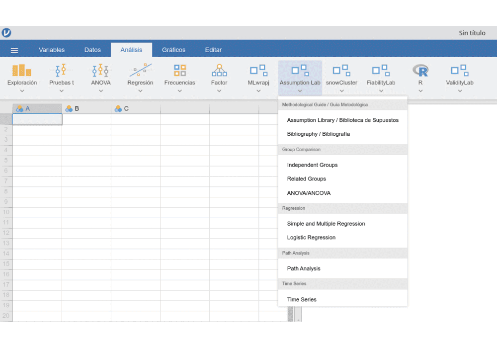
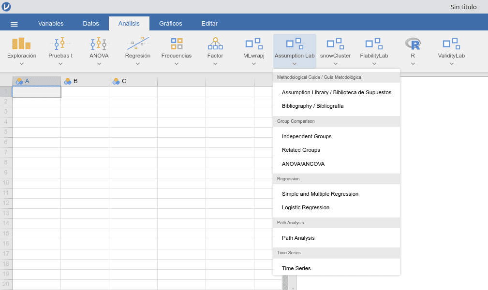
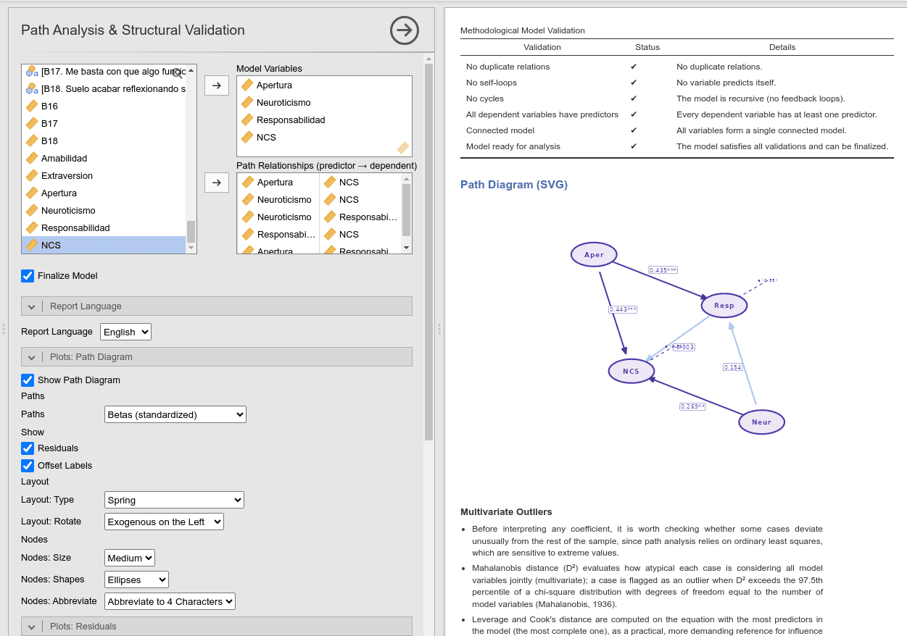
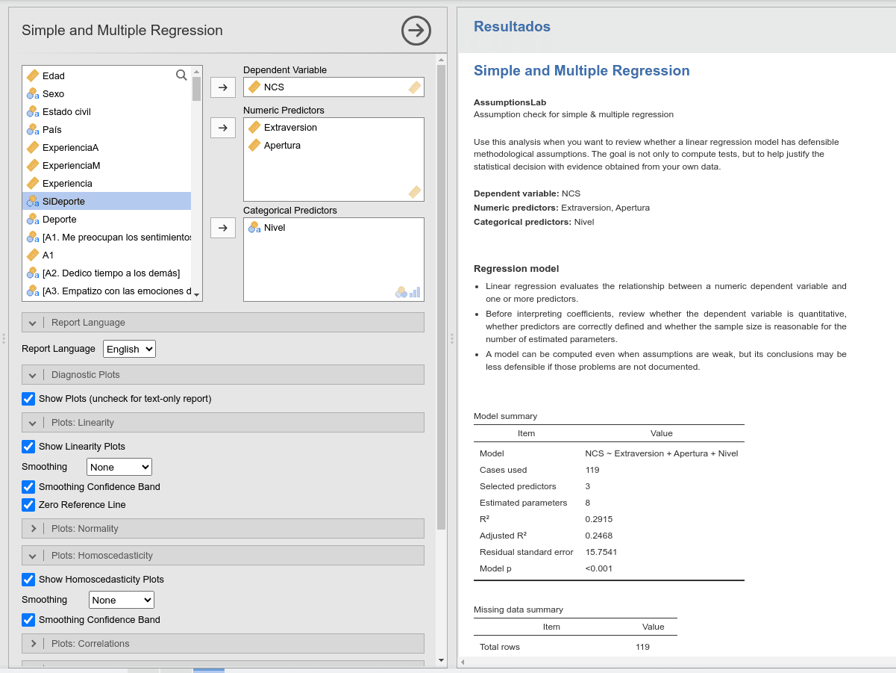
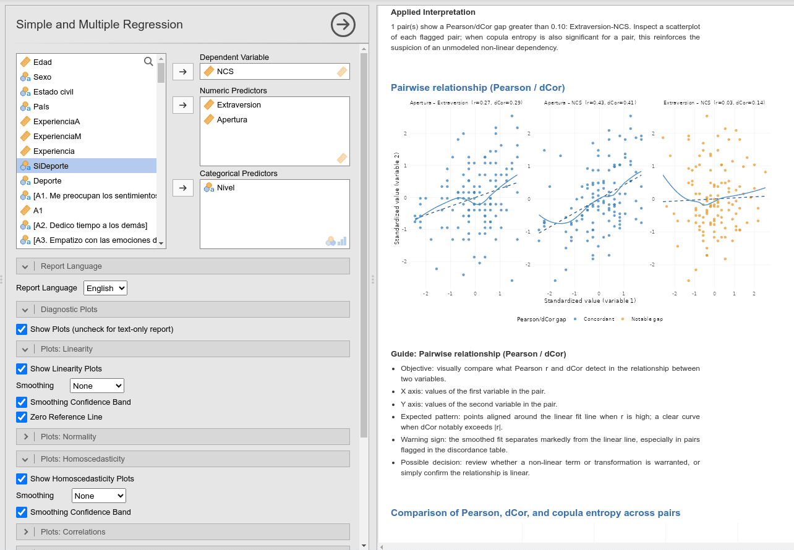
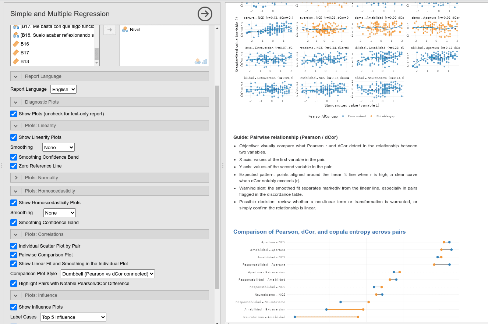
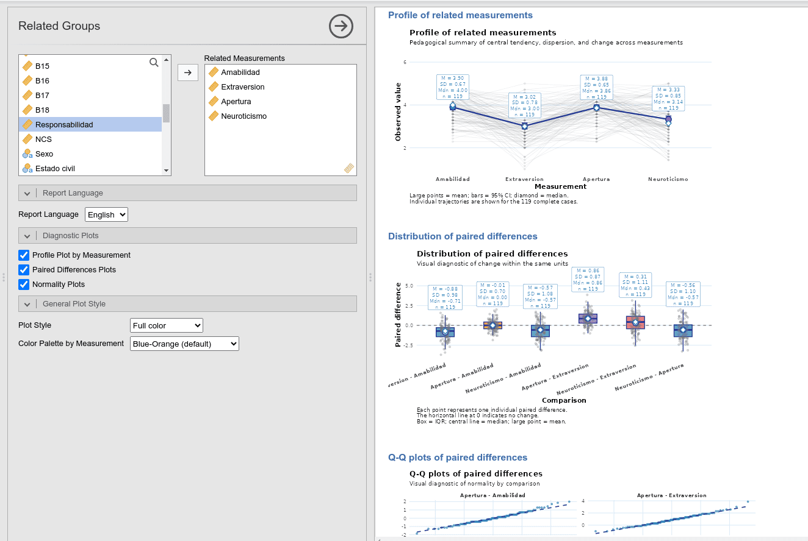
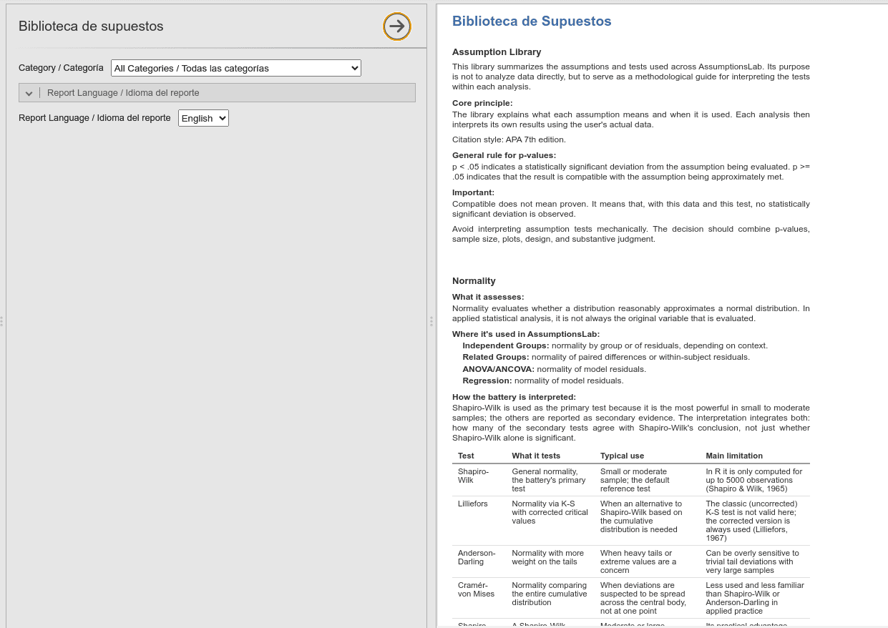

<p align="center">
  <picture>
    <source media="(prefers-color-scheme: dark)" srcset="docs/logo/assumptionslab-logo-dark.svg">
    
  </picture>
</p>

<p align="center">
  <a href="LICENSE"></a>
  <a href="https://github.com/ArchieJamDev/AssumptionsLab/releases"></a>
  <a href="https://doi.org/10.5281/zenodo.22209135"></a>
  
  <a href="https://github.com/ArchieJamDev/AssumptionsLab/actions/workflows/jamovi-check.yml"></a>
  
</p>

> **A jamovi module for statistical assumptions: which assumptions your
> analysis rests on, whether your data meet them, and what to do when they
> do not.**

AssumptionsLab brings assumption checking for the most common analyses to
[jamovi](https://www.jamovi.org/), without writing a line of R. Like its
sibling modules [EGAnetLab](https://github.com/ArchieJamDev/EGAnetLab),
[MokkenLab](https://github.com/ArchieJamDev/MokkenLab),
[FiabilityLab](https://github.com/ArchieJamDev/FiabilityLab) and
[PLSsemLab](https://github.com/ArchieJamDev/PLSsemLab), it does not stop at
the numbers: every option in the menu explains what it does and when to
choose it, and every diagnostic comes with a plain-language interpretation,
the evidence behind it and the next step to take.

---

## Contents

- [Why AssumptionsLab?](#why-assumptionslab)
- [Screenshots](#screenshots)
- [Analyses](#analyses)
- [Methodological Philosophy](#methodological-philosophy)
- [Installation](#installation)
- [Example Dataset](#example-dataset)
- [Validation and Testing](#validation-and-testing)
- [For Developers](#for-developers)
- [Roadmap](#roadmap)
- [Contributing](#contributing)
- [Citation](#citation)
- [License & Author](#license--author)
- [Resumen en español](#resumen-en-español)

---

## Why AssumptionsLab?

Statistical assumptions are usually treated as a checklist run once, just
before the analysis. But they shape the whole study: which model to fit,
whether its results can be trusted and how to interpret them. And the
checks themselves are easy to misread: a single normality test is
underpowered in small samples and oversensitive in large ones, and a
Pearson correlation says nothing about a curved relationship.

AssumptionsLab treats assumption checking as **graduated evidence**: several
diagnostics for each assumption, read together, with a recommendation that
follows from all of them rather than from one *p* value. It puts the whole
workflow in jamovi's point-and-click interface:

- **Guidance with every table.** A short guide before each result and an
  interpretation after it, in English or Spanish, following jamovi's own
  language setting.
- **One workflow for every analysis.** Validation, diagnostics,
  interpretation and recommendation, in the same order everywhere, so
  learning one analysis transfers to the next.
- **Beyond linear association.** Pearson correlations sit next to distance
  correlation and copula entropy, so non-linear relationships are not
  missed.
- **A built-in Assumption Library.** A glossary of every assumption and test
  the module uses, filterable by category.
- **Native citations.** Every method-backed table cites its own source in
  jamovi's numbered reference format; the full APA 7th edition bibliography
  is in [`docs/Bibliography.md`](docs/Bibliography.md).

---

## Screenshots

<p align="center">
  
</p>

<table width="100%">
  <tr>
    <td align="center" width="50%">
      
      <p><em>The Assumption Lab menu in jamovi</em></p>
    </td>
    <td align="center" width="50%">
      
      <p><em>Path Analysis and structural validation</em></p>
    </td>
  </tr>
  <tr>
    <td align="center" width="50%">
      
      <p><em>Regression models and diagnostics</em></p>
    </td>
    <td align="center" width="50%">
      
      <p><em>Pearson vs. distance correlation and copula entropy</em></p>
    </td>
  </tr>
  <tr>
    <td align="center" width="50%">
      
      <p><em>Influence and scatter diagnostics</em></p>
    </td>
    <td align="center" width="50%">
      
      <p><em>Related Groups analysis</em></p>
    </td>
  </tr>
  <tr>
    <td align="center" colspan="2">
      
      <p><em>The built-in Assumption Library</em></p>
    </td>
  </tr>
</table>

---

## Analyses

Each analysis is one entry in the **Assumption Lab** menu, and each option
inside it carries its own explanation.

### Group comparisons

| Analysis | Question it answers | Status |
|---|---|---|
| **Independent Groups** | Is each group normal, are the variances equal (Levene), are there outliers, and should you use the independent-samples *t* test, Welch's test or Mann-Whitney *U*? | ✅ Done |
| **Related Groups** | Are the paired differences normal and, with three or more measures, is sphericity tenable (Mauchly), so that a paired *t* test or repeated-measures ANOVA fits better than Wilcoxon or Friedman? | ✅ Done |
| **ANOVA/ANCOVA** | Are the residuals normal and the variances equal, are the regression slopes homogeneous, is each covariate linear, and are there collinear predictors or influential cases (Cook's D, leverage)? | ✅ Done |

### Regression

| Analysis | Question it answers | Status |
|---|---|---|
| **Simple and Multiple Regression** | Is each predictor linear, are the residuals homoscedastic (Breusch-Pagan) and normal, is there multicollinearity (VIF), are there influential cases, and does Pearson's *r* miss a non-linear relationship (distance correlation, copula entropy)? | ✅ Done |
| **Logistic Regression** | Is each predictor linear in the logit (Box-Tidwell), is there multicollinearity, is the model calibrated and does it discriminate (ROC/AUC), and are there influential cases? | ✅ Done |
| **Ordinal Logistic Regression** | Does the proportional-odds assumption hold (Brant test), is each predictor linear in the cumulative logit, and are there collinear predictors or influential cases? | ✅ Done |
| **Multinomial Logistic Regression** | Does the independence of irrelevant alternatives hold (Hausman-McFadden), is each predictor linear for every category, how accurate is the classification, and are there collinear predictors or influential cases? | ✅ Done |

### Structural models and time series

| Analysis | Question it answers | Status |
|---|---|---|
| **Path Analysis** | Built with an interactive path-diagram builder: are the residuals normal and free of outliers, and are the relationships between variables linear or non-linear (distance correlation, copula entropy)? | ✅ Done |
| **Time Series** | For ARIMA, SARIMA, ETS, VAR, VECM and GARCH models: is the series stationary, are the residuals free of autocorrelation, and is there seasonality? | ✅ Done |

### Methodological guide

| Analysis | Question it answers | Status |
|---|---|---|
| **Assumption Library** | What does each assumption and test above mean, and why does it matter? A reference glossary, filterable by category, not a data analysis. | ✅ Done |

---

## Methodological Philosophy

1. **Support decisions, do not replace them.** The software informs the
   researcher's methodological choice; it never makes it silently.
2. **Evidence over a single test.** Every recommendation rests on several
   diagnostics and on the published literature behind them.
3. **Explain, then report.** Guides before results, interpretations after,
   in the language jamovi is set to.
4. **Learning is part of the analysis.** Methodological knowledge is
   available inside the analysis, exactly when it is needed, not in a
   separate manual.
5. **Transparent failure.** When something cannot be computed, the output
   says what and why, instead of silently dropping it.

---

## Installation

AssumptionsLab is not yet in the official jamovi Library: it is being
prepared for submission. Until then, install it from a release file.

### From a release (recommended)

1. Download the latest `.jmo` file from
   [Releases](https://github.com/ArchieJamDev/AssumptionsLab/releases).
2. In jamovi, open the **⋮** menu (top right) → **Modules** →
   **Install from file**, and choose the `.jmo` file.
3. The **Assumption Lab** menu appears in the Analyses ribbon.

### From source

```r
install.packages("jmvtools", repos = c("https://repo.jamovi.org", "https://cran.r-project.org"))
jmvtools::install()   # from the repository root, with jamovi installed
```

---

## Example Dataset

AssumptionsLab ships one example dataset. Open it from jamovi's **⋮** →
**Open** → **Data Library** → **AssumptionsLab**.

| Dataset | What it lets you try |
|---|---|
| **AssumptionsLab Test Dataset** (n = 450) | Survey and financial-behaviour data with real relationships, about 3% missing values and a few deliberate outliers: every analysis in the module, from group comparisons to time series |

[`data/README.md`](data/README.md) documents every column, its source and
what each analysis currently finds on it.

---

## Validation and Testing

- [`tests/testthat/`](tests/testthat) exercises every analysis on
  pathological input: accented and symbol column names, a single-row data
  set, an entirely missing column, a zero-variance column, constant
  predictors and factors with the minimum number of levels. Each case must either finish or stop with an
  AssumptionsLab message that explains what to change, never with a raw R
  error.
- Every push and pull request runs the GitHub Actions workflow
  [`jamovi-check.yml`](.github/workflows/jamovi-check.yml):
  `jmvtools::check()`, a plain `R CMD INSTALL` and the full test suite.
- [`validation/`](validation/) evaluates the module's own decision rules,
  not just its code: Monte Carlo studies of the normality battery for raw
  variables and for regression residuals, a check of the distance
  correlation vs. Pearson linearity heuristic, and a case study on public
  data (`lavaan` and `psychTools`) in which 20 of the module's outputs are
  compared with independent reference implementations; all 20 match. See
  [`validation/README.md`](validation/README.md) for the design, scope and
  run time of each script.

---

## For Developers

- [ARCHITECTURE.md](ARCHITECTURE.md): how the module is built and why.
- [DEVELOPER_GUIDE.md](DEVELOPER_GUIDE.md): how to build a new analysis.
- [CODE_STYLE.md](CODE_STYLE.md): conventions for R, YAML and texts.
- [docs/Bibliography.md](docs/Bibliography.md): the references behind every
  result.
- [NEWS.md](NEWS.md): what changed in each version.

```r
jmvtools::prepare()                   # regenerate .h.R files from the YAML
jmvtools::install()                   # build and install into jamovi
testthat::test_dir("tests/testthat")  # run the edge-case suite
```

---

## Roadmap

| Phase | Content | Status |
|---|---|---|
| 0 | Platform, group comparisons, ANOVA/ANCOVA, Assumption Library | ✅ Done |
| 1 | Linear, logistic, ordinal and multinomial regression | ✅ Done |
| 2 | Path Analysis and Time Series | ✅ Done |
| 3 | Test suite and CI, native jamovi citations and bibliography | ✅ Done |
| 4 | Monte Carlo validation and public-data case study | ✅ Done |
| 5 | Reports in jamovi's own language through its translation catalog (version 1.7.0) | 🔄 In progress |
| 6 | Submission to the jamovi Library | 🔄 In progress |
| Next | SEM and PLS-SEM, Bayesian methods, multilevel models, survival analysis, meta-analysis | 🗓 Planned |

See [ARCHITECTURE.md](ARCHITECTURE.md#14-future-expansion) for the design
rationale of future analyses.

---

## Contributing

Bug reports, ideas and pull requests are welcome. Please read
[CONTRIBUTING.md](CONTRIBUTING.md) first.

---

## Citation

If you use AssumptionsLab in your research, please cite the module.
Citation metadata is in [CITATION.cff](CITATION.cff) (GitHub's **Cite this
repository** button uses it). Every release is archived in Zenodo. The DOI
[10.5281/zenodo.22209135](https://doi.org/10.5281/zenodo.22209135) covers
all versions and always resolves to the latest one; each version also has
its own DOI, listed on the Zenodo page.

> Chacón Chacón, A. D. L. (2026). *AssumptionsLab: A jamovi module for
> statistical assumptions* (Version 1.6.0) [Computer software]. Zenodo.
> https://doi.org/10.5281/zenodo.22209135

The methods behind each analysis are listed in
[docs/Bibliography.md](docs/Bibliography.md).

---

## License & Author

AssumptionsLab is released under the [GNU General Public License v3.0](LICENSE).

**Arquímedes De León Chacón Chacón**: Psychologist · Data Scientist ·
Research Methodologist. Project Founder and Lead Developer.
Universidad Católica Andrés Bello (UCAB), Caracas, Venezuela.
[ORCID](https://orcid.org/0000-0002-7014-7513)

Copyright © 2026 Arquímedes De León Chacón Chacón

---

## Resumen en español

**AssumptionsLab** es un módulo de jamovi para evaluar los supuestos
estadísticos de los análisis más habituales: comparación de grupos
independientes y relacionados, ANOVA/ANCOVA, regresión lineal simple y
múltiple, regresión logística, logística ordinal y logística multinomial,
análisis de rutas y series temporales (ARIMA, SARIMA, ETS, VAR, VECM y
GARCH). Para cada supuesto reúne varias pruebas (normalidad, homogeneidad de
varianzas, linealidad, multicolinealidad, casos influyentes, odds
proporcionales, independencia de alternativas irrelevantes, estacionariedad,
autocorrelación, entre otras) y emite una recomendación basada en el
conjunto de la evidencia, no en un único valor *p*. Junto a la correlación
de Pearson muestra la correlación de distancia y la entropía de cópula, para
no pasar por alto relaciones no lineales.

Cada opción del menú incluye un párrafo que explica qué hace y cuándo
conviene elegirla, y los resultados se acompañan de guías e
interpretaciones en español o inglés, según el idioma configurado en
jamovi. Incluye una Biblioteca de Supuestos, un glosario de cada supuesto y
prueba filtrable por categoría, y cada tabla cita sus fuentes con el formato
de referencias de jamovi.

Aún no está en la Biblioteca oficial de jamovi (se está preparando el
envío). Para instalarlo, descargue el archivo `.jmo` desde
[Releases](https://github.com/ArchieJamDev/AssumptionsLab/releases) y, en
jamovi, use **⋮** → **Modules** → **Install from file**.

El módulo incluye un conjunto de datos de ejemplo (n = 450) para probar
todos los análisis, documentado en [`data/README.md`](data/README.md). Cada
cambio pasa por pruebas automáticas con datos ausentes, muestras pequeñas y
otros casos límite, y la carpeta [`validation/`](validation/) contiene
estudios de Monte Carlo y un caso con datos públicos que comparan los
resultados del módulo con implementaciones de referencia independientes.
